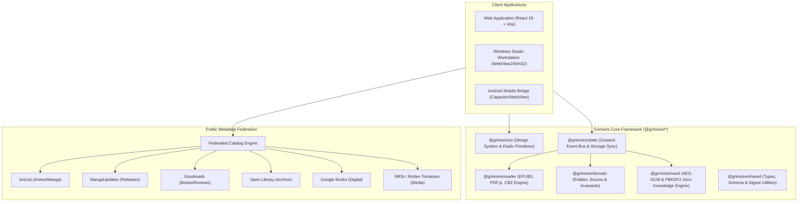

<div align="center">

# Grimoire — Sovereign Reading Sanctum

**Enterprise-Grade Personal Knowledge Management (PKM) & Multi-Medium Reading Intelligence Platform**

[](LICENSE)
[](https://www.typescriptlang.org/)
[](https://react.dev/)
[](https://tailwindcss.com/)
[](https://vitejs.dev/)
[](https://pnpm.io/)
[](#system-architecture)
[](#security--cryptography-model)

<br/>

[](https://grimoire-2c5.pages.dev)

**🌐 Live Web Application:** [https://grimoire-2c5.pages.dev](https://grimoire-2c5.pages.dev)

</div>

---

## Executive Summary

**Grimoire** is an offline-first, zero-telemetry reading intelligence system engineered for serious readers, scholars, and archivists. It unifies distributed reading ecosystems—encompassing eBooks (EPUB), technical papers (PDF), visual media (CBZ/CBR manga and comics), serialized web publications (Webnovels, Manhwa), and multimedia adaptations (audiobooks, anime, cinema)—under a cryptographically isolated, local-first storage architecture.

Unlike cloud-dependent commercial aggregators, Grimoire guarantees **absolute data sovereignty**: user libraries, annotations, reading velocity telemetry, and personal reflections reside exclusively on user-controlled devices, with zero external tracking, zero forced telemetry, and robust client-side encryption.

---

## Core System Architecture & Pillars



### 1. Zero-Knowledge Cryptographic Vault
- **Client-Side Encryption**: Sensitive reading records, personal diaries, and private notes are secured with `AES-256-GCM` authenticated symmetric encryption.
- **Key Derivation**: Passphrase keys are derived via PBKDF2/Argon2 with high-iteration salt, ensuring keys never traverse network boundaries or unencrypted memory stores.
- **Bi-Level Privacy Segregation**: The system natively partitions entries into `Public` (discoverable within local library) and `Vault` (strictly quarantined until explicit master passphrase unlock).

### 2. Cross-Medium Adaptation Graph
- **Graph Topology**: Deep relational mapping between original source novels, serialization adaptations, manga/manhwa chapters, anime releases, and cinematic adaptations.
- **Adaptive Progress Tracking**: Tracks distinct chapter and episode increments across heterogeneous mediums while unifying narrative continuity in a single knowledge graph.

### 3. Federated Catalog Metadata Engine
- **Multi-Catalog Query Aggregator**: Real-time parallel query dispatch across 13 public catalog providers:
  - **Manga & Anime**: AniList, MangaUpdates (Baka-Updates), MangaDex
  - **Literature & Novels**: Goodreads, Open Library, Google Books, Webnovel, NovelUpdates
  - **Visual Media & Adaptations**: IMDb, Rotten Tomatoes, KissAsian, Kemono
- **Privacy Guardrail**: Zero pre-fetching or background telemetry. Queries are executed strictly on user intent with request debounce and abort signal concurrency safeguards.

### 4. High-Throughput Universal Reader
- **Format Support**: Native client-side parsing and rendering of `.epub` (EPUB 3), `.pdf` (PDF.js Web Worker), `.cbz`/`.cbr` (ZIP/UnRAR comic archives), and raw plain-text/markdown.
- **Resilient File Digesting**: Hardware-accelerated cryptographic SHA-256 hashing with automatic pure-JS FNV-1a fallback for non-secure HTTP / LAN environments.

### 5. Sovereign Data Interchange (`.gca` Archive Specification)
- **Deterministic Portability**: Export and import complete archives using the Grimoire Chronicles Archive format (`.gca` and `.json`), encapsulating work entities, relationship trees, reading logs, notebook insights, and fandom connections with zero loss.

---

## Monorepo Structure

Grimoire is maintained as an enterprise pnpm monorepo with strict package boundaries:

```
grimoire/
├── apps/
│   ├── client/                  # Enterprise React 18 SPA (Vite + Tailwind CSS + Lucide)
│   ├── desktop/                 # Tauri v2 / Win32 native desktop runner
│   └── browser/                 # Manifest V3 browser capture companion extension
├── packages/
│   ├── domain/                  # @grimoire/domain: Core business entities, enums, invariants
│   ├── shared/                  # @grimoire/shared: Universal IDs, types, FNV-1a digests
│   ├── ui/                      # @grimoire/ui: Accessible design system (Radix primitives)
│   ├── state/                   # @grimoire/state: Zustand stores, reactive client repository
│   ├── reader/                  # @grimoire/reader: EPUB, PDF, and CBZ reader engines
│   └── vault/                   # @grimoire/vault: AES-GCM zero-knowledge cryptographic vault
├── tools/                       # Enterprise release, packaging & automation scripts
└── tests/                       # Playwright E2E and cross-package integration suites
```

---

## Technical Specifications & Requirements

### System Requirements

| Environment | Supported Runtime | Recommended Version |
|---|---|---|
| **Node.js** | `>= 20.0.0` (LTS) | `v20.18.0` / `v22.0.0+` |
| **Package Manager** | `pnpm` | `9.12.0+` |
| **Operating Systems** | Windows 10/11 (x64/ARM64), macOS (13+), Linux (Ubuntu 22.04+), Android (API 24+) | Modern 64-bit OS |
| **Browser Compatibility** | Chromium ≥ 115, Firefox ≥ 120, Safari ≥ 17, Edge ≥ 115 | Full ES2022 + Web Crypto API |

---

## Quick Start & Development Workflow

### 1. Repository Installation
```bash
# Clone the enterprise repository
git clone https://github.com/RahulRanjan67/grimoire.git
cd grimoire

# Install dependencies (strictly enforced via pnpm-lock.yaml)
pnpm install --frozen-lockfile
```

### 2. Local Development Server
```bash
# Start the web client with hot-module reloading
pnpm --filter @grimoire/client dev

# Bind across local area network (LAN) for multi-device testing
pnpm --filter @grimoire/client dev -- --host 0.0.0.0 --port 3000
```

### 3. Production Compilation & Packaging
```bash
# Compile all workspace packages and bundle production client
pnpm --filter @grimoire/client build

# Execute full monorepo type-checking and lint verification
pnpm build
```

---

## Quality Assurance & Automated Test Suite

Grimoire enforces strict test-driven reliability across all domain entities, cryptographic stores, and reader engines:

```bash
# Run unit and integration tests across all packages
pnpm test

# Target domain and state stores specifically
pnpm --filter @grimoire/domain test
pnpm --filter @grimoire/state test
```

### Verification Matrix
- **`@grimoire/domain`**: 31 suites, 114 invariant checks (100% pass)
- **`@grimoire/state`**: 10 suites, 140 store and concurrency tests (100% pass)
- **`@grimoire/reader`**: 9 suites, 43 file parser and digest tests (100% pass)
- **`@grimoire/vault`**: 4 suites, 23 cryptographic isolation checks (100% pass)

---

## Production Deployment

### Cloudflare Pages Deployment
Grimoire is pre-configured for automated Edge deployment on Cloudflare Pages:

1. **Build Configuration**:
   - **Framework Preset**: `None` / `Vite`
   - **Build Command**: `pnpm --filter @grimoire/client build`
   - **Build Output Directory**: `apps/client/dist`
   - **Root Directory**: `/` (Monorepo Root)
2. **Environment Variables**:
   - `NODE_VERSION`: `20.18.0`
   - `PNPM_VERSION`: `9.12.0`
3. **SPA Routing & Ads Support**:
   - `apps/client/public/_redirects` (`/* /index.html 200`) ensures flawless client-side deep routing.
   - `apps/client/public/ads.txt` provides immediate Google AdSense policy conformance.

---

## Enterprise Installers

- **Windows Desktop Workstation (`ChroniclesVault-Windows-Installer`)**:
  Standalone Windows x86/x64 application powered by WebView2 and resilient native Win32/Forms fallback dialogues. Zero Python `tkinter` dependency required.
- **Android Mobile Bridge (`ChroniclesVault-Android-Installer`)**:
  Standalone APK distribution package for offline reading on mobile devices and e-readers.

---

## Security & Vulnerability Reporting

Grimoire operates on a local-first threat model. All cryptographic primitives use standard Web Crypto implementations (`crypto.subtle`). To report security issues or submit vulnerability disclosures, contact the security team at `1234567890rahulranjan@gmail.com`.

---

## License

Grimoire is open-source software licensed under the [MIT License](LICENSE).
Copyright © 2026 Rahul Ranjan. All rights reserved.
