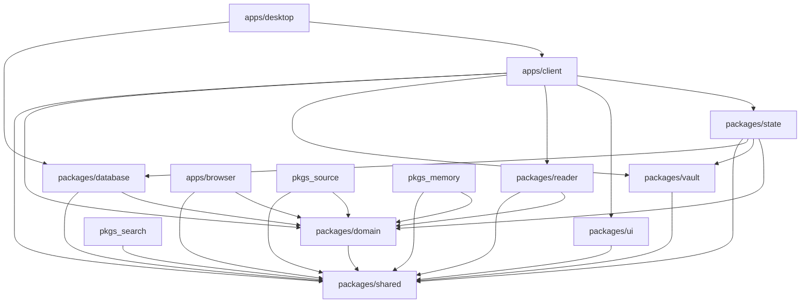

# Chronicles Vault — System Architecture & Data Flow

## 1. System Overview

Chronicles Vault is a high-performance, local-first, privacy-sovereign reading intelligence platform. It bridges the physical, digital, and web reading experiences of serious readers into an encrypted, searchable personal archive.

The system is constructed as a strictly bounded TypeScript monorepo orchestrated with pnpm workspaces and Turborepo, featuring a modern React frontend targeted at web and a planned Capacitor native shell, complemented by browser extensions and an optional headless API service.

```
┌────────────────────────────────────────────────────────────────────────┐
│                              APPLICATIONS                              │
│ apps/client (Vite/React + planned Capacitor shell)     apps/browser    │
└────────────────────────────────────┬───────────────────────────────────┘
                                     │
┌────────────────────────────────────▼───────────────────────────────────┐
│                           APPLICATION STATE                            │
│                        packages/state (Zustand)                        │
└──────────────────┬─────────────────┬─────────────────┬─────────────────┘
                   │                 │                 │
┌──────────────────▼──────┐   ┌──────▼──────┐   ┌──────▼──────┐
│     READER SUBSYSTEM    │   │ VAULT (SEC) │   │   SOURCES   │
│     packages/reader     │   │packages/vlt │   │packages/src │
└──────────────────┬──────┘   └──────┬──────┘   └──────┬──────┘
                   │                 │                 │
┌──────────────────▼─────────────────▼─────────────────▼─────────────────┐
│                           DOMAIN & ENTITIES                            │
│                        packages/domain (Pure)                          │
└────────────────────────────────────┬───────────────────────────────────┘
                                     │
┌────────────────────────────────────▼───────────────────────────────────┐
│                          STORAGE & REPOSITORIES                        │
│                 packages/database (SQLite 3 + FTS5)                    │
└────────────────────────────────────┬───────────────────────────────────┘
                                     │
┌────────────────────────────────────▼───────────────────────────────────┐
│                             FOUNDATION                                 │
│                     packages/shared (Types/Utils)                      │
└────────────────────────────────────────────────────────────────────────┘
```

---

## 2. Workspace Package Responsibilities

### 2.1 Applications (`apps/`)
- **`apps/client`**: Primary user interface built with React 18, Vite, TanStack Router, and Tailwind CSS. Implements the Library Grid, Return Desk, Reading Shell, Settings, and Memory Timeline.
- **`apps/client`**: React/Vite web client and planned Capacitor iOS/Android shell. Native capabilities must be introduced through explicitly selected Capacitor plugins and narrow validated APIs; no native shell is scaffolded yet.
- **`apps/browser/chromium` & `firefox`**: Browser extensions (Manifest V3) allowing one-click capture of articles, web serial chapters, and metadata directly from active browser tabs into Chronicles Vault.

### 2.2 Core Packages (`packages/`)
- **`packages/domain`**: Pure, business-logic heart of the system. Contains aggregate roots (`Work`, `ReadingRelationship`), entities (`AccessPath`, `Memory`, `LoreEntry`), value objects (`ProgressAnchor`, `UpdateEntry`), and strict invariant assertions. Zero external UI or database dependencies.
- **`packages/database`**: Data persistence engine. Manages SQLite schema definitions, transactional migrations, performance indexes, triggers, and the FTS5 virtual full-text index.
- **`packages/vault`**: Cryptographic boundary. Manages Argon2id KDF password derivation, AES-256-GCM encryption/decryption, non-extractable WebCrypto key sessions, idle auto-locking, and protected repositories.
- **`packages/ui`**: Shared design system. Exposes semantic design tokens (`--cv-*`), 4px spacing utilities, custom hooks (`useDebounce`, `useIntersectionObserver`), accessible primitives, and fallback cover generators.
- **`packages/state`**: Zustand state stores. Encapsulates reactive UI state for library filtering, active reader viewport, vault authentication status, and capture batch triage.
- **`packages/reader`**: Reader abstractions and format engines. Provides uniform `ReaderAdapter` interfaces for EPUB reflowable text, PDF canvas rendering, and CBZ/CBR manga/comic viewers.
- **`packages/source`**: Provider ecosystem. Manages `AccessPath` adapters, background health checking, update polling, and the Token Bucket network rate limiter.
- **`packages/search`**: Full-text search builder. Constructs high-performance FTS5 queries with BM25 ranking, prefix matching, and tag filtering.
- **`packages/memory`**: Memory capture and reflection services. Aggregates reading timelines, formats quote exports (Markdown, Obsidian, JSON), and extracts insights.
- **`packages/shared`**: Low-level primitives. Contains branded identifier types (`WorkId`), the canonical `Result<T, E>` pattern, and date/URL normalization utilities.

### 2.3 Standalone Services (`services/`)
- **`services/api`**: Optional headless FastAPI backend enabling self-hosting on Linux servers, NAS appliances, or headless Raspberry Pi home hubs.

---

## 3. Package Dependency Graph



---

## 4. End-to-End Data Flows

### 4.1 Reading Progress Write Flow
```
User Turns Page in Reader
         │
         ▼
ReaderAdapter.getCurrentPosition() -> ProgressLocator
         │
         ▼
ProgressAnchor Value Object Created
         │
         ▼
Domain Invariant Validation (validateAnchor)
         │
         ▼
SQLite Transaction (BEGIN IMMEDIATE)
  ├─ INSERT INTO progress_events
  ├─ UPDATE reading_relationships SET last_active_at = now()
  └─ UPDATE access_paths SET last_opened_at = now()
         │
         ▼
COMMIT Transaction
         │
         ▼
Domain Event Emitted: 'reading:progress_updated'
         │
         ▼
Zustand Store Notified (Updates Shelf UI & Return Desk)
```

### 4.2 Full-Text Search Query Flow
```
User Types in Search Input
         │
         ▼
useDebounce Hook (150ms buffer)
         │
         ▼
Search Query Sanitized (Special chars escaped)
         │
         ▼
SQLite FTS5 Query Executed:
  SELECT entity_id, title, snippet(search_fts, 3, '<b>', '</b>', '...', 16)
  FROM search_fts
  WHERE search_fts MATCH '...'
  ORDER BY bm25(search_fts) LIMIT 30;
         │
         ▼
Hydrate Matching Works & Memories from DB
         │
         ▼
Render Highlighted Results in Command Palette (< 40ms)
```

### 4.3 Vault Lock / Unlock Flow
```
User Submits Master Passphrase
         │
         ▼
Argon2id Derives KEK (64MB, 3 iterations) (~700ms)
         │
         ▼
AES-256-GCM Unwraps DEK
         │
         ▼
Non-Extractable CryptoKey Loaded into Session Store
         │
         ▼
Emit Domain Event: 'vault:unlocked'
         │
         ▼
Zustand Stores Re-fetch Queries:
  - Decrypt Vault Memories via AES-GCM
  - Append Private Books to Library Grid
         │
         ▼
Subtle 200ms Fade-in of Private Records (NO PAGE RELOAD)
```

### 4.4 Browser Extension Capture Ingestion
```
User Clicks "Vault Capture" in Browser
         │
         ▼
Extension Extracts: URL, Title, Selected Text, Favicon
         │
         ▼
Normalized Payload Transmitted to App via WebSocket / Local HTTP / File
         │
         ▼
Persisted into `captures` table (state: 'pending')
         │
         ▼
Capture Matcher analyzes URL against known AccessPaths
  ├─ Match Found (> 85% confidence): Suggest link to existing Work
  └─ No Match: Suggest creating new Work with title pre-filled
         │
         ▼
Badge Count Increments on App Return Desk
```
