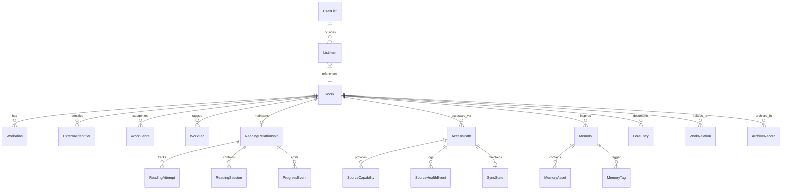

# Chronicles Vault — Domain Entities & Invariants Contract

## 1. Architectural Philosophy

Chronicles Vault models a reader's intellectual engagement with creative and scholarly works. The domain model separates the **objective representation** of an intellectual work from the **subjective relationship** an individual reader maintains with it, the **concrete access paths** through which it is read, the **recorded memories** captured along the way, and the **security boundaries** that keep that information private.

### Core Domain Invariants
1. **Separation of Work and Relationship**: A `Work` exists independently of whether a user has read it. Subjective progress, ratings, and state belong strictly to `ReadingRelationship`.
2. **Immutability of Historical Events**: `ProgressEvent`, `ReadingSession`, `ArchiveRecord`, and `Memory` captures are append-only or versioned; history is never retroactively rewritten.
3. **Privacy by Compartmentalization**: Privacy level (`public`, `private`, `vault`) is evaluated on an entity-by-entity basis. Vault entities cannot be queried or hydrated unless the cryptographic session is unlocked.
4. **Branded Type Safety**: All domain identifiers are branded strings (`WorkId`, `ReadingRelationshipId`, etc.) to prevent accidental key transposition.

---

## 2. Entity Definitions

### 2.1 Work (Aggregate Root)

#### Purpose
Represents an objective, trackable intellectual property or media item (book, light novel, manga, comic, webtoon, academic paper, etc.). It acts as the root anchor for reading progress, access paths, memories, and series relationships.

#### Fields
| Field | TypeScript Type | DB Column | Required | Description |
|---|---|---|:---:|---|
| `id` | `WorkId` (branded UUID v4) | `id` (TEXT) | Yes | Primary key. |
| `title` | `string` | `title` (TEXT) | Yes | Primary canonical display title (non-empty). |
| `alternativeTitles` | `readonly string[]` | Table: `work_aliases` | Yes | Alternative names, romanizations, translated variants. |
| `aliases` | `readonly string[]` | Table: `work_aliases` | Yes | Colloquial short names, abbreviations (e.g., "OPM"). |
| `description` | `string \| null` | `description` (TEXT) | No | Long-form synopsis or publisher blurb. |
| `contentType` | `ContentType` | `content_type` (TEXT) | Yes | Enum: `manga`, `manhwa`, `manhua`, `webtoon`, `light_novel`, `web_novel`, `western_novel`, `anime`, `donghua`, `epub`, `pdf`, `cbz`. |
| `origin` | `ContentOrigin` | `origin` (TEXT) | Yes | Enum: `korean`, `japanese`, `chinese`, `western`, `original`, `unknown`. Default: `unknown`. |
| `publicationState` | `PublicationState` | `publication_state` (TEXT) | Yes | Enum: `ongoing`, `completed`, `hiatus`, `cancelled`, `unknown`. Default: `unknown`. |
| `privacyState` | `PrivacyState` | `privacy_state` (TEXT) | Yes | Enum: `public`, `private`, `vault`. Default: `public`. |
| `coverRef` | `string \| null` | `cover_ref` (TEXT) | No | Local URI, hash, or relative path to cached cover image. |
| `externalIds` | `readonly ExternalIdentifier[]` | Table: `work_external_ids` | Yes | External identifiers (ISBN, AniList, MangaUpdates, Goodreads). |
| `genres` | `readonly string[]` | Table: `work_genres` | Yes | Canonical genres (e.g., "Fantasy", "Cyberpunk"). |
| `tags` | `readonly string[]` | Table: `work_tags` | Yes | Freeform user- or source-assigned tags. |
| `createdAt` | `string` (ISO 8601 UTC) | `created_at` (TEXT) | Yes | Timestamp when the record was created. |
| `updatedAt` | `string` (ISO 8601 UTC) | `updated_at` (TEXT) | Yes | Timestamp of last modification. |
| `deletedAt` | `string \| null` (ISO 8601 UTC) | `deleted_at` (TEXT) | No | Soft-delete timestamp. Null if active. |

#### Invariants
- `title.trim().length > 0` must always hold. Empty or whitespace-only titles are rejected.
- `createdAt` and `updatedAt` must be valid ISO 8601 UTC date strings. `updatedAt >= createdAt`.
- When `deletedAt` is non-null, the work is soft-deleted and excluded from default queries.
- Deletion cascade: Deleting a `Work` cascades to its aliases, external IDs, genres, tags, reading relationships, access paths, and lore entries.

#### Lifecycle
```
[Created / Imported] ──> [Active Library Entity] ──> [Soft Deleted (deletedAt set)] ──> [Purged / Hard Deleted]
                                │                              ▲
                                └───> [Archived (Via Record)] ─┘
```

---

### 2.2 ReadingRelationship

#### Purpose
Captures the user's subjective, personal stance toward a `Work`. Represents whether the user is planning, currently reading, pausing, completing, or abandoning the work. Exactly one `ReadingRelationship` exists per `Work`.

#### Fields
| Field | TypeScript Type | DB Column | Required | Description |
|---|---|---|:---:|---|
| `id` | `ReadingRelationshipId` | `id` (TEXT) | Yes | Primary key. |
| `workId` | `WorkId` | `work_id` (TEXT) | Yes | Foreign key to `works.id` (UNIQUE). |
| `personalState` | `PersonalState` | `personal_state` (TEXT) | Yes | Enum: `planned`, `reading`, `on_hold`, `completed`, `dropped`, `rereading`. Default: `planned`. |
| `priority` | `ReadingPriority` | `priority` (TEXT) | Yes | Enum: `low`, `normal`, `high`, `urgent`. Default: `normal`. |
| `startedAt` | `string \| null` | `started_at` (TEXT) | No | Timestamp of first active reading interaction. |
| `lastActiveAt` | `string \| null` | `last_active_at` (TEXT) | No | Timestamp of most recent progress update or session. |
| `completedAt` | `string \| null` | `completed_at` (TEXT) | No | Timestamp when marked completed. |
| `stoppedAt` | `string \| null` | `stopped_at` (TEXT) | No | Timestamp when abandoned or placed on hold. |
| `stoppedReason` | `string \| null` | `stopped_reason` (TEXT) | No | Structured reason (e.g., `translation_stalled`, `lost_interest`). |
| `stoppedNote` | `string \| null` | `stopped_note` (TEXT) | No | Freeform explanation of why reading halted. |
| `rating` | `number \| null` | DB column or app setting | No | User rating (0.5 to 10.0 scale, step 0.5). |
| `createdAt` | `string` | `created_at` (TEXT) | Yes | Timestamp created. |
| `updatedAt` | `string` | `updated_at` (TEXT) | Yes | Timestamp updated. |

#### Invariants
- `work_id` has a `UNIQUE` constraint: a user has at most one active relationship record per work.
- If `personalState === 'completed'`, `completedAt` should be recorded (defaults to current timestamp if omitted).
- If `personalState === 'dropped'`, `stoppedAt` should be set.
- If `startedAt` is present and `completedAt` is present, `completedAt >= startedAt`.
- If `lastActiveAt` is present, `lastActiveAt >= startedAt`.

#### Lifecycle Transitions
```
                ┌──────────────────────────────────────┐
                ▼                                      │
          [ planned ] ───(start)───> [ reading ] ──(re-read)──┐
                │                         │   │               │
                │                         │   └──(hold)──┐    │
                │                         │              ▼    │
                │                         │          [ on_hold ]
                │                         │              │
                │                         ▼              │
                └───(drop)────────────> [ dropped ] <────┘
                                          │   ▲
                                          │   │
                                          └───┴───> [ completed ]
```

---

### 2.3 AccessPath

#### Purpose
Represents a concrete location, service, file, or protocol from which a `Work` can be opened, read, or synchronized. A single work may have multiple access paths (e.g., local EPUB on disk + Web version on MangaDex + Physical volume on bookshelf).

#### Fields
| Field | TypeScript Type | DB Column | Required | Description |
|---|---|---|:---:|---|
| `id` | `AccessPathId` | `id` (TEXT) | Yes | Primary key. |
| `workId` | `WorkId` | `work_id` (TEXT) | Yes | Reference to owning work. |
| `kind` | `AccessPathKind` | `kind` (TEXT) | Yes | Enum: `web`, `local_file`, `feed`, `manual`. |
| `provider` | `string \| null` | `provider` (TEXT) | No | Provider identifier (e.g., `local-reader`, `mangadex`, `ao3`, `custom-web`). |
| `label` | `string \| null` | `label` (TEXT) | No | User-facing title (e.g., "Official Web Translation", "Local EPUB"). |
| `url` | `string \| null` | `url` (TEXT) | No | Canonical web URL if `kind === 'web' \| 'feed'`. |
| `fileId` | `string \| null` | `file_id` (TEXT) | No | Foreign key to `local_files.id` if `kind === 'local_file'`. |
| `isPreferred` | `boolean` | `is_preferred` (INTEGER 0/1) | Yes | Flag indicating default path to launch when user clicks "Read". |
| `health` | `SourceHealth` | `health_state` (TEXT) | Yes | Canonical enum: `healthy`, `degraded`, `unavailable`, `stale`, `unknown`, `local`, `broken`. Default: `unknown` (`healthState` mirrored for legacy compatibility). |
| `lastCheckedAt` | `string \| null` | `last_checked_at` (TEXT) | No | Timestamp of most recent connectivity or file existence check. |
| `lastOpenedAt` | `string \| null` | `last_opened_at` (TEXT) | No | Timestamp when the user last accessed this path. |
| `provenance` | `AccessPathProvenance \| null` | `provenance` (TEXT JSON) | No | Metadata regarding origin (e.g. extension import, auto-detected file). |
| `createdAt` | `string` | `created_at` (TEXT) | Yes | ISO 8601 creation timestamp. |
| `updatedAt` | `string` | `updated_at` (TEXT) | Yes | ISO 8601 update timestamp. |

#### Invariants
- If `kind === 'web'`, `url` must not be null and must be a valid URI.
- If `kind === 'local_file'`, `filePath` must not be empty.
- At most one `AccessPath` for a given `workId` can have `isPreferred = 1`. Setting one preferred automatically clears the preferred flag on sibling paths.

---

### 2.4 ProgressAnchor (Value Object)

#### Purpose
A polymorphic, format-agnostic locator specifying exact reading progress. It is stored as a serialized JSON string in database tables (`progress_events.anchor_after`, `reading_attempts.final_anchor`, `memories.progress_anchor`). Legacy payloads using `kind` or `chapterNumber`/`percentage` are normalized via `normalizeProgressAnchor(raw)` into this canonical union.

#### Discriminated Union Shape
```typescript
export type ProgressAnchor =
  | ChapterAnchor
  | EpisodeAnchor
  | PageAnchor
  | PercentAnchor
  | EpubLocatorAnchor
  | VolumeChapterAnchor
  | ProviderLocatorAnchor;

export interface ChapterAnchor {
  readonly type: 'chapter';
  readonly chapter: number;
  readonly subchapter?: number; // For Chapter 42.5
  readonly title?: string;
}

export interface EpisodeAnchor {
  readonly type: 'episode';
  readonly episode: number;
  readonly timecode?: string;   // e.g. '18:42'
}

export interface PageAnchor {
  readonly type: 'page';
  readonly page: number;
  readonly totalPages?: number;
}

export interface PercentAnchor {
  readonly type: 'percent';
  readonly percent: number;     // 0.0 to 100.0
}

export interface EpubLocatorAnchor {
  readonly type: 'epub_locator';
  readonly cfi: string;         // EPUB canonical fragment identifier (e.g. "epubcfi(/6/4[chap01]!/4/2/10/1:0)")
  readonly percent?: number;
  readonly chapterTitle?: string;
}

export interface VolumeChapterAnchor {
  readonly type: 'volume_chapter';
  readonly volume: number;
  readonly chapter: number;
  readonly title?: string;
}

export interface ProviderLocatorAnchor {
  readonly type: 'provider';
  readonly locator: string;
  readonly display: string;
}
```

#### Invariants
- `page >= 0` and `page <= totalPages` if `totalPages` is known.
- `percent >= 0.0 && percent <= 100.0`.
- All anchors must have a valid `type` discriminator matching one of the union variants (legacy `kind` discriminators are normalized at ingestion via `normalizeProgressAnchor`).

---

### 2.5 Memory & MemoryAsset

#### Purpose
Captures reader reflections, annotations, highlights, pull quotes, screenshots, or reviews tied to a specific work, location, and reading moment.

#### Fields: Memory
| Field | TypeScript Type | DB Column | Required | Description |
|---|---|---|:---:|---|
| `id` | `MemoryId` | `id` (TEXT) | Yes | Primary key. |
| `workId` | `WorkId \| null` | `work_id` (TEXT) | No | Linked work, or null if cross-cutting standalone memory. |
| `type` | `MemoryType` | `type` (TEXT) | Yes | Enum: `note`, `screenshot`, `quote`, `review`, `reaction`. |
| `title` | `string \| null` | `title` (TEXT) | No | Optional memory title or heading. |
| `body` | `string \| null` | `body` (TEXT) | No | Markdown content of the thought, note, or quote. |
| `privacyState` | `PrivacyState` | `privacy_state` (TEXT) | Yes | Enum: `public`, `private`, `vault`. Default: `private`. |
| `spoilerLevel` | `SpoilerLevel` | `spoiler_level` (TEXT) | Yes | Enum: `spoiler_free`, `minor_spoiler`, `major_spoiler`. Default: `spoiler_free`. |
| `showInGlobalGallery`| `boolean` | `show_in_global_gallery` (INTEGER 0/1) | Yes | Whether image/quote appears in dashboard gallery stream. |
| `accessPathId` | `AccessPathId \| null`| `access_path_id` (TEXT)| No | The specific edition/source where note was taken. |
| `progressAnchor` | `ProgressAnchor \| null`| `progress_anchor` (TEXT JSON)| No | Exact reading position when memory was captured. |
| `createdAt` | `string` | `created_at` (TEXT) | Yes | Creation timestamp. |
| `updatedAt` | `string` | `updated_at` (TEXT) | Yes | Last modification timestamp. |

#### Fields: MemoryAsset
| Field | TypeScript Type | DB Column | Required | Description |
|---|---|---|:---:|---|
| `id` | `MemoryAssetId` | `id` (TEXT) | Yes | Primary key. |
| `memoryId` | `MemoryId` | `memory_id` (TEXT) | Yes | Owning memory foreign key. |
| `assetType` | `MemoryAssetType` | `asset_type` (TEXT) | Yes | Enum: `image`, `video`, `file`. |
| `fileId` | `string` | `file_id` (TEXT) | Yes | Reference to stored binary payload in filesystem or vault store. |
| `thumbnailRef`| `string \| null` | `thumbnail_ref` (TEXT) | No | Fast thumbnail preview reference. |
| `width` | `number \| null` | `width` (INTEGER) | No | Dimensions for image assets. |
| `height` | `number \| null` | `height` (INTEGER) | No | Dimensions for image assets. |
| `createdAt` | `string` | `created_at` (TEXT) | Yes | Creation timestamp. |

#### Invariants
- At least one of `title`, `body`, or an associated `MemoryAsset` must be non-empty. An entirely empty memory record is forbidden.
- If `privacyState === 'vault'`, the memory body, title, tags, and assets are encrypted at rest using AES-256-GCM.
- In-reader highlights produce a `Memory` of type `quote` with `progressAnchor` populated.

---

### 2.6 Capture & CaptureBatch

#### Purpose
Captures transient URLs, tabs, and bookmarks collected via the browser extension, bookmarklet, or clipboard, awaiting review, triage, or automatic association with a `Work`.

#### Fields: Capture
| Field | TypeScript Type | DB Column | Required | Description |
|---|---|---|:---:|---|
| `id` | `CaptureId` | `id` (TEXT) | Yes | Primary key. |
| `batchId` | `CaptureBatchId \| null`| `batch_id` (TEXT) | No | Grouping batch ID (e.g. single tab sweep). |
| `url` | `string \| null` | `url` (TEXT) | No | Raw target URL. |
| `normalizedUrl` | `string \| null` | `normalized_url` (TEXT) | No | Canonicalized URL stripped of tracking params. |
| `title` | `string \| null` | `title` (TEXT) | No | Page title extracted at capture time. |
| `faviconRef` | `string \| null` | `favicon_ref` (TEXT) | No | Cached favicon icon data URL or asset ID. |
| `browser` | `string \| null` | `browser` (TEXT) | No | Browser identifier (`chrome`, `firefox`, etc.). |
| `windowLabel` | `string \| null` | `window_label` (TEXT) | No | Browser window or session label. |
| `capturedAt` | `string` | `captured_at` (TEXT) | Yes | Capture timestamp. |
| `possibleWorkId`| `WorkId \| null` | `possible_work_id` (TEXT)| No | Machine-suggested matching Work in library. |
| `confidenceScore`| `number \| null` | `confidence_score` (REAL)| No | Match confidence (0.0 to 1.0). |
| `state` | `CaptureState` | `state` (TEXT) | Yes | Enum: `pending`, `matched`, `dismissed`, `archived`. Default: `pending`. |
| `createdAt` | `string` | `created_at` (TEXT) | Yes | Creation timestamp. |

#### Invariants
- `state` transitions:
  - `pending` -> `matched` (associates URL as an AccessPath of `possibleWorkId` or creates new Work).
  - `pending` -> `dismissed` (user rejects item).
  - `pending` / `matched` -> `archived`.

---

### 2.7 ArchiveRecord

#### Purpose
Preserves a snapshot of a `Work` and its state when a user archives or drops it, ensuring that reading velocity metrics, historical timestamps, and contextual rationale remain intact without polluting active library shelves.

#### Fields
| Field | TypeScript Type | DB Column | Required | Description |
|---|---|---|:---:|---|
| `id` | `ArchiveRecordId` | `id` (TEXT) | Yes | Primary key. |
| `workId` | `WorkId` | `work_id` (TEXT) | Yes | Reference to archived work. |
| `reason` | `string` | `reason` (TEXT) | Yes | Primary reason category (e.g. `finished`, `dropped_bad_quality`, `clearing_backlog`). |
| `note` | `string \| null` | `note` (TEXT) | No | Reader's reflective note explaining why. |
| `previousState`| `string \| null` | `previous_state` (TEXT) | No | Snapshot of `ReadingRelationship.personalState`. |
| `previousProgress`| `ProgressAnchor \| null`| `previous_progress` (TEXT JSON)| No | Snapshot of reading progress at moment of archive. |
| `archivedAt` | `string` | `archived_at` (TEXT) | Yes | Timestamp of archive action. |

---

### 2.8 Publication & UserList

#### Purpose
`UserList` enables custom collections (e.g., "Top 10 Sci-Fi Novels", "Manga to Read on Flights"). `Publication` represents an exportable, shareable snapshot or catalog curated from a list, ready for external sharing or static website generation.

#### Fields: UserList
| Field | TypeScript Type | DB Column | Required | Description |
|---|---|---|:---:|---|
| `id` | `UserListId` | `id` (TEXT) | Yes | Primary key. |
| `title` | `string` | `title` (TEXT) | Yes | Display name. |
| `description` | `string \| null` | `description` (TEXT) | No | List commentary. |
| `privacyState` | `PrivacyState` | `privacy_state` (TEXT) | Yes | Default: `private`. |
| `createdAt` | `string` | `created_at` (TEXT) | Yes | ISO 8601. |
| `updatedAt` | `string` | `updated_at` (TEXT) | Yes | ISO 8601. |

#### Fields: ListItem
| Field | TypeScript Type | DB Column | Required | Description |
|---|---|---|:---:|---|
| `id` | `ListItemId` | `id` (TEXT) | Yes | Primary key. |
| `listId` | `UserListId` | `list_id` (TEXT) | Yes | Owning list. |
| `workId` | `WorkId` | `work_id` (TEXT) | Yes | Reference to work. |
| `position` | `number` | `position` (INTEGER) | Yes | Sort order index (0-indexed, unique within list). |
| `personalNote` | `string \| null` | `personal_note` (TEXT) | No | Custom commentary specific to this entry in this list. |
| `createdAt` | `string` | `created_at` (TEXT) | Yes | Creation timestamp. |

---

### 2.9 WorkRelation

#### Purpose
Defines explicit directed or symmetric links between two works, forming series graphs, universe connections, or adaptations.

#### Fields
| Field | TypeScript Type | DB Column | Required | Description |
|---|---|---|:---:|---|
| `id` | `WorkRelationId` | `id` (TEXT) | Yes | Primary key. |
| `sourceWorkId` | `WorkId` | `source_work_id` (TEXT)| Yes | Origin work. |
| `targetWorkId` | `WorkId` | `target_work_id` (TEXT)| Yes | Linked work. |
| `relationType` | `WorkRelationType`| `relation_type` (TEXT)| Yes | Enum: `sequel`, `prequel`, `spinoff`, `adaptation`, `alternative`, `related`. |
| `createdAt` | `string` | `created_at` (TEXT) | Yes | Timestamp link established. |

#### Invariants
- `sourceWorkId !== targetWorkId`: A work cannot be related to itself.
- Compound uniqueness: `(sourceWorkId, targetWorkId, relationType)` must be unique.

---

### 2.10 LoreEntry

#### Purpose
World-building database for complex fiction and research. Readers record characters, factions, artifacts, historical events, magic systems, or world lore discovered while reading.

#### Fields
| Field | TypeScript Type | DB Column | Required | Description |
|---|---|---|:---:|---|
| `id` | `LoreEntryId` | `id` (TEXT) | Yes | Primary key. |
| `workId` | `WorkId` | `work_id` (TEXT) | Yes | Foreign key to `works.id`. |
| `entityType` | `LoreEntityType` | `entity_type` (TEXT) | Yes | Enum: `character`, `location`, `faction`, `concept`, `item`, `event`. |
| `name` | `string` | `name` (TEXT) | Yes | Display name of the lore subject. |
| `description` | `string \| null` | `description` (TEXT) | No | Brief identity or definition. |
| `notes` | `string \| null` | `notes` (TEXT) | No | Markdown comprehensive lore notes. |
| `createdAt` | `string` | `created_at` (TEXT) | Yes | Creation timestamp. |
| `updatedAt` | `string` | `updated_at` (TEXT) | Yes | Update timestamp. |

---

## 3. Entity Relationship Diagram


