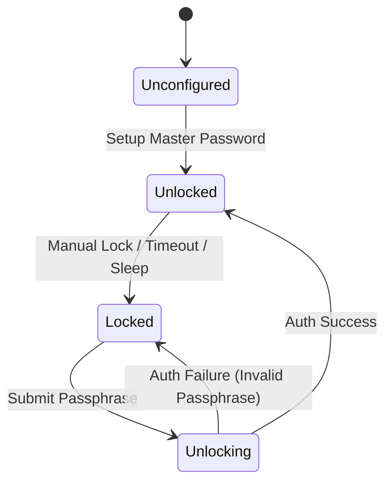

# Chronicles Vault — Vault Security & Cryptographic Contract

## 1. Security Model & Architecture

The Vault is the sovereign security boundary in Chronicles Vault. It safeguards user privacy, sensitive reading journals, private ratings, and confidential highlights. The security posture is defined by the guarantee that **data classified as `vault` is unreadable at rest on the storage device without the user's master passphrase**.

```
Passphrase + Salt ──(Argon2id)──> Key Encryption Key (KEK)
                                        │
                                  (AES-256-GCM)
                                        │
                                        ▼
                             Data Encryption Key (DEK)
                                        │
           ┌────────────────────────────┼────────────────────────────┐
           ▼                            ▼                            ▼
    Private Memories             Encrypted Notes              Private Shelves
```

---

## 2. Cryptographic Parameters & Key Hierarchy

### 2.1 Key Derivation Function (KDF)
Argon2id is used for resistant password hashing against GPU and ASIC brute-force attacks.

| Parameter | Value | Rationale |
|---|---|---|
| **Algorithm** | `Argon2id` (v13) | Recommended standard combining data-dependent and independent memory passes. |
| **Salt Length** | 32 bytes (256 bits) | Cryptographically secure random bytes generated via `crypto.getRandomValues`. |
| **Memory Cost (`m`)** | `65536` KB (64 MB) | High memory footprint making mass parallel GPU attacks prohibitive. |
| **Time Cost (`t`)** | `3` iterations | Execution duration ~500ms to 1000ms on desktop hardware. |
| **Parallelism (`p`)** | `1` thread | Single-threaded consistency across low-power and multi-core systems. |
| **Derived Key Length** | 32 bytes (256 bits) | Matches AES-256 key sizing. |

### 2.2 Symmetric Encryption Cipher
- **Algorithm**: `AES-256-GCM` (Galois/Counter Mode).
- **Initialization Vector (IV)**: 12 random bytes (96 bits) generated fresh per encryption call via CSPRNG. Reusing an IV with the same key is strictly impossible.
- **Authentication Tag**: 16 bytes (128 bits) appended to the ciphertext to ensure tamper-proofing and integrity verification. Wrong passphrases trigger immediate authentication failure exceptions (`DOMException: OperationError`).

### 2.3 Non-Extractable Key Storage
Derived keys in JavaScript (web or Capacitor WebView) are wrapped as non-extractable WebCrypto `CryptoKey` objects:
```typescript
const key = await crypto.subtle.importKey(
  'raw',
  rawBytes,
  { name: 'AES-GCM', length: 256 },
  false, // extractable = false (prevents serialization to disk or logs)
  ['encrypt', 'decrypt']
);
// Immediately wipe raw byte buffers
rawBytes.fill(0);
```

---

## 3. Session State Machine & Lifecycle

### 3.1 Vault States
```typescript
export enum VaultState {
  /** No vault configured yet; first-time onboarding needed. */
  Unconfigured = 'unconfigured',
  /** Master password set; key is purged from memory; data encrypted. */
  Locked = 'locked',
  /** Currently computing Argon2id hash. UI shows spinner. */
  Unlocking = 'unlocking',
  /** DEK resides in volatile memory; vault records are queryable. */
  Unlocked = 'unlocked',
}
```



### 3.2 Auto-Lock & Idle Detection
1. **Configurable Timeout**: Default 15 minutes (Options: 5m, 15m, 30m, 1h, Never).
2. **Activity Tracking**: Global listeners on `window` for `pointerdown`, `keydown`, and `scroll` reset the idle timer using a debounced tick (every 30s max to minimize overhead).
3. **Emergency Lock**: Pressing `Cmd+Shift+L` or `Ctrl+Shift+L` triggers instant locking within < 5 milliseconds.
4. **System Sleep / App Blur**: The web client locks when the document becomes hidden. A future Capacitor host must also subscribe to the Capacitor App lifecycle becoming inactive and lock before returning to the background.

---

## 4. Protected Repository Interface

The `ProtectedRepository<T>` pattern ensures application services interact transparently with entities while maintaining strict cryptographic boundaries.

```typescript
export interface EncryptedEnvelope {
  readonly version: 1;
  readonly algorithm: 'aes-gcm-256';
  readonly ivBase64: string;
  readonly ciphertextBase64: string;
}

export interface ProtectedRepository<TEntity, TId> {
  /**
   * Save an entity. If privacyState === 'vault', data fields are encrypted
   * before storing in the database.
   */
  save(entity: TEntity): Promise<Result<TEntity, Error>>;

  /**
   * Find by ID. If entity is encrypted and vault is locked, returns an
   * opaque LockedPlaceholder representation or error.
   */
  findById(id: TId): Promise<Result<TEntity | null, Error>>;

  /**
   * Query records matching filter. Automatically includes or excludes
   * vault-protected records based on current VaultState.
   */
  findMany(filter: Record<string, unknown>): Promise<Result<readonly TEntity[], Error>>;
}
```

---

## 5. Zero-Reload Reactive Update Flow

Chronicles Vault **NEVER** reloads the web page or triggers hard full-window refreshes upon locking or unlocking. All transitions are managed reactively via Zustand stores:

### 5.1 On Unlock
1. The user enters their passphrase and clicks "Unlock".
2. Argon2id derives the KEK, unwraps the DEK, and stores the `CryptoKey` in the session manager.
3. The session manager emits `vault:unlocked`.
4. Domain stores (Works, Memories, Shelves) re-run their active queries in the background.
5. Vault-protected records decrypt seamlessly and append into the active UI lists with a subtle 200ms fade transition.

### 5.2 On Lock
1. The lock event `vault:locked` fires.
2. The active `CryptoKey` reference is set to `null` and GC is triggered.
3. Domain stores instantly purge all vault-protected records from state.
4. UI views currently displaying protected content gracefully replace the content with a placeholder ("This record is locked in your Vault").
5. The reader closes immediately if the currently open book is a vault-protected file.
