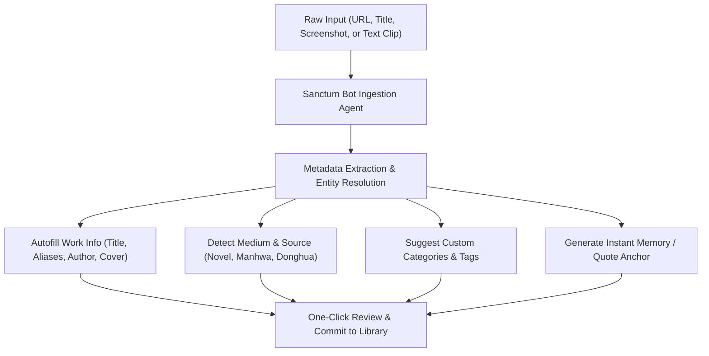

# Grimoire — Future Product Roadmap & Architectural Blueprint

**Author:** Grimoire Engineering & Design Architecture Team  
**Document Status:** Approved Strategic Roadmap  
**Target Versions:** v2.0 (Design & Micro-Interactions Overhaul) & v3.0 (AI Sanctum Assistant & Autonomous Work Cataloging)  

---

## Executive Summary

Grimoire is evolving from a local-first functional prototype into a world-class, authentic literary and visual media sanctum. To eliminate the generic, hyper-saturated aesthetic of typical AI-generated interfaces ("AI slop"), Grimoire will undergo a radical design and interaction transformation in **Version 2.0**, inspired by top-tier contemporary web design standards (Emil Kowalski micro-interactions, Awwwards Site-of-the-Year candidates, Linear/Raycast density, and Editorial/Literary minimalism). 

In **Version 3.0**, Grimoire will introduce the **Sanctum Bot AI Assistant**, an ambient, zero-friction knowledge-engine that relieves users of the burden of manual metadata entry, work classification, and quote clipping.

---

## Phase 1: Version 2.0 — Aesthetic Overhaul & Tangible Craft (Anti-"AI Slop")

### 1. The Anti-Pattern: What Makes Interfaces Look Like "AI Slop"?
* **Over-reliance on generic gradients:** Purple-to-pink gradient pills and glowing cyan outer glows that convey superficial "futuristic" themes without purpose.
* **Artificial uniform padding:** Rigid cards that float in empty voids without structural hierarchy, typographic rhythm, or editorial grid logic.
* **Lifeless transitions:** Linear opacity fades and stiff popups that lack physical weight, spring physics, or gestural momentum.
* **Stock visual tropes:** Random icons attached to every single header without editorial necessity.

### 2. Design Philosophy & Inspiration Anchors
* **Emil Kowalski Micro-Interactions:**
  * Physics-based spring animations (`framer-motion` / CSS `linear()` timing functions) with natural mass, damping, and stiffness.
  * Shared layout animations (`layoutId`) when expanding books, covers, and memory drawers so elements physically morph rather than abruptly appear.
  * Tactile button press states (`active:scale-[0.98]` with instantaneous 40ms press-down and elastic spring-back).
  * Interactive drag-to-dismiss sheets with velocity-aware gesture tracking.
* **Awwwards & Editorial Typography:**
  * Curated typographic pairings: High-contrast serif headlines (*Fraunces*, *Newsreader*, or *Playfair Display*) paired with hyper-legible geometric mono accents (*Geist Mono*, *JetBrains Mono*) and humanistic body text (*Inter Tight* or *Lora*).
  * Asymmetric, magazine-grade grid layouts: Works presented not as endless identical cards, but as curated anthologies with editorial pull-quotes, spine-binding visuals, and variable-density shelf viewports.
* **Tactile Materiality (Physicality & Depth):**
  * True paper grain textures in *Antique Parchment* theme with ink-bleed borders (`border-image` or subtle SVG turbulences).
  * Deep, non-blurry ambient shadows (`box-shadow: 0 1px 1px rgba(0,0,0,0.08), 0 4px 8px rgba(0,0,0,0.06), 0 16px 32px rgba(0,0,0,0.04)`).
  * Realistic bookbinding spine creases, ribbon bookmark physics, and tactile leather corners in reader views.

### 3. Implementation Deliverables for v2.0
1. **Dynamic Page Turn Physics 2.0:**
   - WebGL / Canvas-accelerated cloth/paper simulation for corner-pull gestures with realistic underside shadowing, specular sheen, and curl stiffness.
2. **Fluid Command Navigation:**
   - Raycast-style command bar (`⌘K` / `Ctrl+K`) with instant keyboard navigation, contextual breadcrumbs, and preview drawer.
3. **Typography Engine:**
   - User-selectable typeface pairings (Classic Book Serifs, High-Density System Sans, Japanese/CJK-optimized Mincho fonts).
4. **Adaptive Contextual Headers:**
   - Auto-collapsing slim navigation bars that preserve vertical reading canvas and transition smoothly on scroll.
5. **Grimoire Companion Browser Extension (Google Chrome & Brave — Manifest V3):**
   - **Target Browsers:** Chromium-based ecosystems (Google Chrome, Brave, Edge, Opera, Vivaldi).
   - **Zero-Friction Ingestion Pipeline:**
     - Contextual Omni-Button & Right-Click Actions (`"Add to Grimoire Sanctum"` or `"Capture Chapter Anchor"`).
     - **Automatic URL & Medium Detection:** Deep scrapers for popular web reading platforms (Royal Road, Syosetu, KakaoPage, Naver Series, MangaDex, MangaUpdates, NovelUpdates, Webtoons, Bilibili Comics, ScribbleHub, AO3).
     - **Intelligent Chapter & Progress Sniffing:** DOM mutation observers and URL pattern heuristics detect currently viewed chapter number, volume, scroll percentage, and latest available releases without manual user entry.
     - **One-Click Local Deep Progress Sync:** Automatically advances your Grimoire reading relationship anchor via local HTTP bridge (`http://localhost:3000` / `http://localhost:5173` or WebSocket bridge to PC Studio) with zero copy-pasting.
     - **Ambient Memory & Quote Clipper:** Highlight text on any web page -> right click -> `"Save Quote as Sanctum Memory"`, with automatic source attribution, chapter stamp, and emotional tagging.
     - **Offline & Air-Gapped Privacy Architecture:** Built strictly on Manifest V3 declarative APIs; zero external tracking, zero third-party telemetry, and zero unencrypted cloud transmission.

---

## Phase 2: Version 3.0 — AI Sanctum Assistant & Automated Cataloging

### 1. Problem Statement
Manually entering novel descriptions, chapter numbers, publisher tags, cover images, author bios, and alternate romanized titles for 500+ novels, manhwas, and anime series is tedious, error-prone, and leads to library abandonment.

### 2. The Solution: Sanctum Bot Assistant
A conversational, local/hybrid AI agent running in the sidebar or command palette that automates the entire ingestion pipeline:



### 3. Core Capabilities of Sanctum Bot
1. **Universal One-Shot URL Scraper & Resolver:**
   - Paste a link from Royal Road, MangaDex, NovelUpdates, Bilibili, VIZ, or Syosetu.
   - The bot automatically queries metadata, extracts high-res cover art, parses latest chapter numbers, detects publication status, and establishes multi-access paths.
2. **Screenshot-to-Memory Vision Pipeline:**
   - Drop a screenshot from a reader app or comic page.
   - The bot performs OCR, identifies the exact novel/manga, determines chapter/page context, extracts the spoken quote, detects potential spoilers, and creates an emotional Memory Card.
3. **Cross-Medium Adaptation Matcher:**
   - Given a web novel, the bot queries known adaptation databases to ask: *"Did you know this novel has a serialized Manhwa and an upcoming Donghua? Would you like me to link them with shared progress tracking?"*
4. **Hiatus & Release Radar AI Summary:**
   - Generates weekly natural-language digest: *"3 of your stalled novels dropped new arcs this week. 'Lord of the Mysteries: Circle of Inevitability' published 14 new chapters since your last session at Chapter 85."*
5. **Zero-Knowledge Local Model Fallback:**
   - Runs locally using WebLLM / Ollama (`gemma-2-2b`, `llama-3.2-3b`) inside the browser or PC Studio, ensuring zero user reading data ever leaves the local device unless explicit cloud sync is requested.

---

## Phase 3: Mobile Native App Rebuild From Scratch (< 100 MB, Zero Security Concerns)

### 1. The Mobile Incompatibility Problem
- **Why Desktop Web UX Fails on Handheld Phones:**
  - Standard web responsive scaling results in awkward micro-buttons, multi-column headers that squeeze onto 360–390px screens, and lack of true native gestures (edge swipes, pull-to-refresh, pinch zoom).
  - Web views on Android often carry browser chrome overhead and sluggish touch-event dispatching compared to hardware-accelerated native surfaces.

### 2. Standalone Mobile Native Architecture
Grimoire Mobile is scheduled to be rebuilt from the ground up as a dedicated touch-native application:
- **Lightweight Native Core (Strictly < 100 MB Installed Footprint):**
  - **APK Package Size:** Target package under **15 MB** (current build is **~3.8 MB**).
  - **Device Storage Footprint:** Strictly capped under **50–80 MB** on disk including core offline readers (EPUB, PDF, CBZ, TXT).
  - **Zero Security & Privacy Risks:**
    - Zero third-party telemetry, tracking SDKs, or ad trackers.
    - Minimal Android manifest permissions: only scoped media reading for local book files (`READ_MEDIA_IMAGES`, `READ_MEDIA_AUDIO`) and optional `INTERNET` solely for user-initiated Cloudflare D1 sync.
    - Local AES-GCM-256 encrypted SQLite storage on device via SQLCipher or Capacitor Secure Storage.
    - Native Android `BiometricPrompt` (Fingerprint / Face Unlock) to unlock the Private Vault with a single tap.

### 3. Thumb-First Mobile UX Ergonomics
- **40% Bottom Reachability Rule:**
  - All critical action controls (Chapter advance, Bookmark, Play/Pause, Vault unlock, Filter chips) are anchored strictly in the bottom 40% of the screen within comfortable one-handed thumb reach.
- **Top Bar De-cluttering:**
  - On mobile, the top bar is stripped to a pure minimal reading status pill; Private Vault and Sync are relocated into the bottom sheet to eliminate icon overlapping.
- **Gesture-Driven Reading Engine:**
  - Edge-swipe page flipping with hardware-accelerated 60fps curl physics.
  - Double-tap margin to advance chapters.
  - Pull-down gesture to dismiss work detail sheets and memory modals.

---

## Architectural File & Codebase Layout

```
Chronicles Vault/
├── grimoire/                      # [Monorepo Web Client & Core Packages]
│   ├── apps/
│   │   ├── client/                # React 18 + Vite Web Application & PWA
│   │   │   ├── src/
│   │   │   │   ├── routes/        # Library, Up Next, Vault, Sync, Reader
│   │   │   │   └── utils/         # Cross-platform sync, local media, vault
│   ├── packages/
│   │   ├── domain/                # Zero-dependency TypeScript business rules
│   │   ├── state/                 # Zustand stores, CRDT sync, SQLite repo
│   │   ├── reader/                # PDF, EPUB, CBZ, TXT/MD/DOCX reader engines
│   │   ├── vault/                 # WebCrypto AES-GCM-256 + PBKDF2 zero-knowledge
│   │   └── ui/                    # Tailwind CSS atomic component library
│   └── tools/                     # Sample pack generator, media synthesizers
│
├── grimoire studio/               # [PC Workstation App & Windows Native Codebase]
│   ├── pc_workstation_app.py      # Native PyQt6 / PySide6 desktop workstation
│   ├── sync_hub_server.py         # Embedded CRDT Hybrid Logical Clock server
│   ├── client_dist/               # Built static client assets bundled in executable
│   └── Grimoire-Studio.exe        # Standalone Windows executable
│
├── grimoire-extension/            # [Chrome & Brave Browser Extension — Manifest V3]
│   ├── manifest.json              # Chrome Web Store & Brave compatible MV3 manifest
│   ├── src/
│   │   ├── background/            # Service worker for local bridge communication & alarms
│   │   ├── content/               # High-accuracy chapter sniffer & quote clipper
│   │   └── popup/                 # Quick shelf switcher, status updater & instant capture
│   └── icons/                     # Extension branding icons
│
└── grimoire Mobile/               # [Mobile App Codebase & Android Native Package]
    ├── android/                   # Capacitor / Gradle Android Studio project
    ├── Grimoire.apk               # Direct offline installable Android package
    └── capacitor.config.ts        # Native file sandbox & SQLite bridge bindings
```
